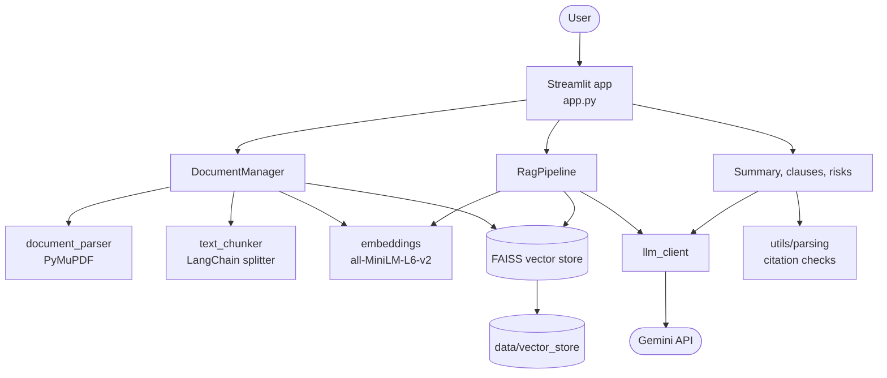
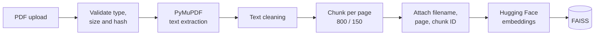
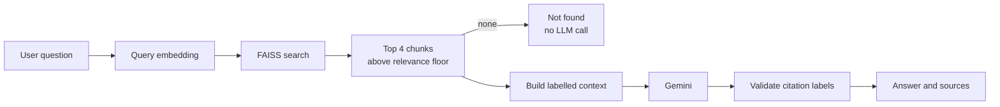
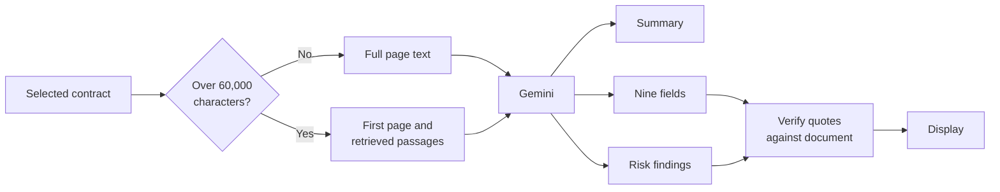
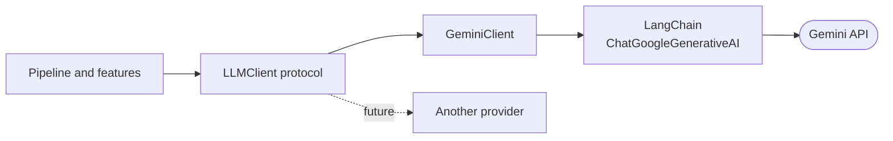
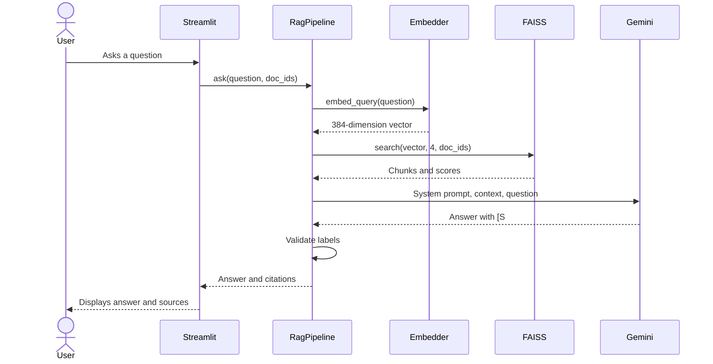

# System Architecture

## Overview

ContractIQ is a single-process local Python application. Streamlit provides the interface and calls ordinary Python modules directly, so there is no separate API server. Two external services are involved: Hugging Face, for the one-time model download, and the Gemini API, for generation.

## Frontend and backend interaction

Streamlit reruns `app.py` from top to bottom after each user action.

- `st.session_state` holds per-session data: the current page, chat history, question count, document selection and analysis results.
- `st.cache_resource` keeps one `DocumentManager` alive across reruns, so the embedding model and FAISS index are not rebuilt.
- `app.py` contains only interface code. Ingestion, retrieval and analysis live in `core/` and `features/`, so they can be tested without a browser.

## Document ingestion

Each file is hashed with SHA-256. The hash is the document ID, so identical content is detected even if the file is renamed. Validation failures are returned as messages and do not stop other files in the same upload.

## Embedding generation

`HuggingFaceEmbedder` wraps `sentence-transformers/all-MiniLM-L6-v2`, which produces 384-dimensional vectors. The model loads on first use and runs locally after its one-time download. Vectors are normalised to unit length. The same model embeds both chunks and queries, which is necessary for their vectors to be comparable.

## FAISS integration

`FaissVectorStore` uses `IndexFlatIP` wrapped in `IndexIDMap2`.

- **`IndexFlatIP`** performs exact inner-product search. For unit vectors, inner product equals cosine similarity.
- **`IndexIDMap2`** links each vector to an application ID, so a document's vectors can be removed.

FAISS stores only vectors. A dictionary maps each vector ID to its `Chunk` metadata. For a document filter, the store searches every vector and keeps matches from the allowed documents, which is simple and exact at MVP scale.

On disk, `data/vector_store/` contains:

| File | Contents |
|---|---|
| `index.faiss` | Serialised vectors |
| `chunks.json` | Chunk text and metadata |
| `documents.json` | Library records and page text |

## RAG architecture

Citations are never taken from the model's claims about a location. The model refers to labels such as `[S1]`, and the code maps each valid label back to the chunk that was actually retrieved. Labels that do not exist are removed.

## Contract analysis

The analysis pipeline sends the whole contract when possible, because a missed page could cause a false "not found". A very long contract falls back to its first page and the most relevant passages, and the interface warns that the result is partial.

Each extracted field and risk finding must carry a quote. The application searches for that quote in the document text and takes the page number from where it is found, not from the model.

## LLM interaction

Application code depends only on the `LLMClient` protocol, which has one method: `generate(system_prompt, user_prompt)`. Adding a provider needs one new class and one line in `create_llm_client`.

## End-to-end data flow

## Trust boundaries

| Boundary | Risk | Control |
|---|---|---|
| Uploaded document to LLM | Prompt injection | Context is delimited and marked untrusted; closing tags in document text are neutralised; the system prompt forbids following embedded instructions |
| LLM output to user | Invented facts or sources | Citation labels and quotes are verified in code; figures are checked against the document |
| LLM output to browser | Data exfiltration through remote images | Images and links are removed; document text is displayed literally |
| Secrets | Key exposure | The key is held only in `.env`, which is ignored by Git and excluded from the ZIP |
| Logs | Contract text exposure | No document text is logged, and exception text is not displayed |
